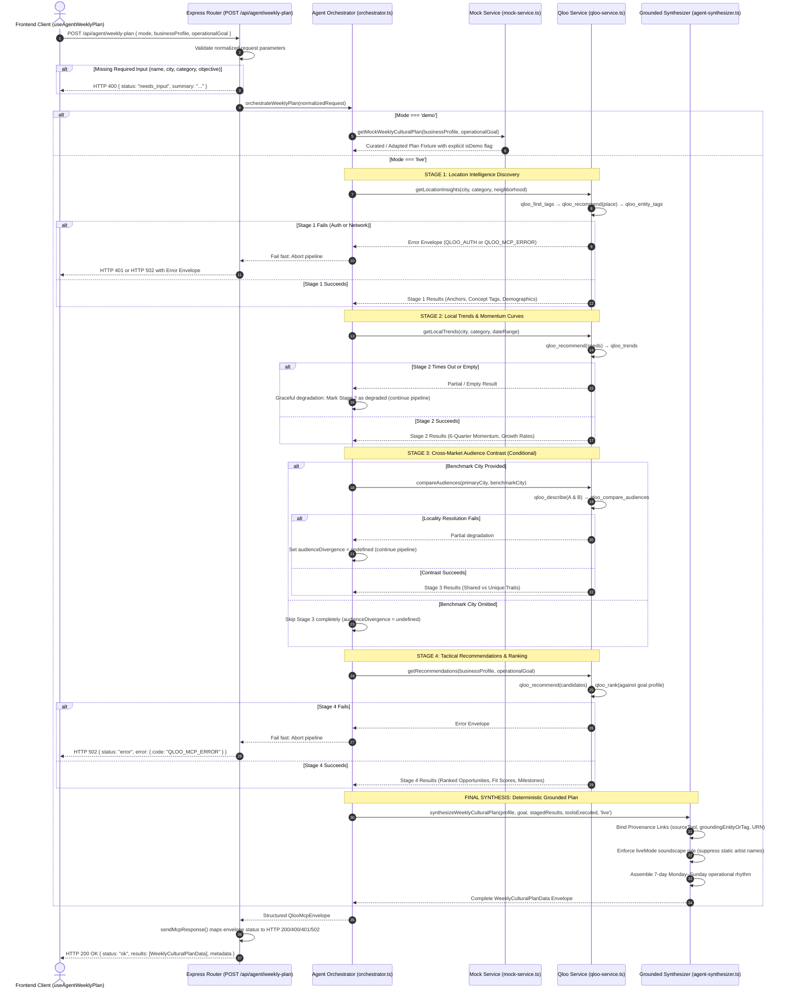

# LocalMuse Ops — Agent Orchestration Architecture

This document details the multi-stage orchestration pipeline inside `server/src/services/agent-orchestrator.ts` and the deterministic synthesizer in `server/src/services/agent-synthesizer.ts`.

---

## 1. Multi-Stage Agent Orchestration Diagram



---

## 2. Orchestration Pipeline Stages

| Stage | Subsystem | MCP Tools Executed | Error Boundary & Degradation Policy |
| :--- | :--- | :--- | :--- |
| **Stage 1: Location Intelligence** | Discover peer anchor venues, lifestyle tags, and target demographic distributions. | `qloo_find_tags`<br/>`qloo_recommend`<br/>`qloo_entity_tags` | **Fatal Boundary**: If missing credentials (`QLOO_API_KEY`) or network failure occurs, the orchestrator immediately halts and emits HTTP 401 (`QLOO_AUTH`) or 502 (`QLOO_MCP_ERROR`). |
| **Stage 2: Local Trends** | Evaluate time-series momentum curves and emerging local shifts across a multi-quarter window. | `qloo_recommend`<br/>`qloo_trends` | **Graceful Partial Degradation**: If no statistically significant trend data is returned or the tool times out, the orchestrator records `source: "qloo_trends (degraded)"` and proceeds with synthesis rather than failing the entire weekly plan. |
| **Stage 3: Audience Contrast** | Contrast the primary market against an optional benchmark expansion city. | `qloo_describe`<br/>`qloo_compare_audiences` | **Conditional Execution**: Skipped completely if no benchmark city is provided. If locality resolution fails in Qloo, sets `audienceDivergence = undefined` and continues pipeline. |
| **Stage 4: Tactical Ranking** | Discover candidate operational initiatives and contextually rank them against the strategic goal. | `qloo_recommend`<br/>`qloo_rank` | **Fatal Boundary**: Ensures initiatives are ranked strictly on real Qloo candidates. If ranking fails, emits HTTP 502. |
| **Final Synthesis** | Coordinate multi-stage signals into an actionable 7-day Monday–Sunday operational rhythm. | Deterministic Synthesizer | **Provenance Verification**: Assigns explicit `origin: "qloo_evidence"` or `origin: "agent_derived"`. In Live Mode, suppresses static illustrative artist palette to prevent unverified discovery claims. |

---

## 3. Strict Provenance Contract

Every recommendation generated by the synthesizer implements the `QlooProvenanceLink` interface:

```typescript
export interface QlooProvenanceLink {
  sourceTool: "qloo_recommend" | "qloo_entity_tags" | "qloo_compare_audiences" | "qloo_trends" | "qloo_rank";
  groundingEntityOrTag: string; // Exact returned entity name or concept tag
  entityUrn?: string;          // e.g. "urn:tag:culinary:cascara"
  empiricalMeasurement?: string;// e.g. "Rank #1 • Fit Score: 95/100"
  interpretationNote: string;  // Explicit explanation of how data translates into hospitality practice
}
```

### RecommendationOrigin Discrimination
- **`qloo_evidence`**: Assigned exclusively when the underlying data point originates directly from a Qloo tool response (e.g. concept tag name, peer anchor venue, time-series momentum rate).
- **`agent_derived`**: Assigned to all operational interpretations synthesized by the agent (e.g. menu item title, pricing rationale, shift milestone, social post copy).
