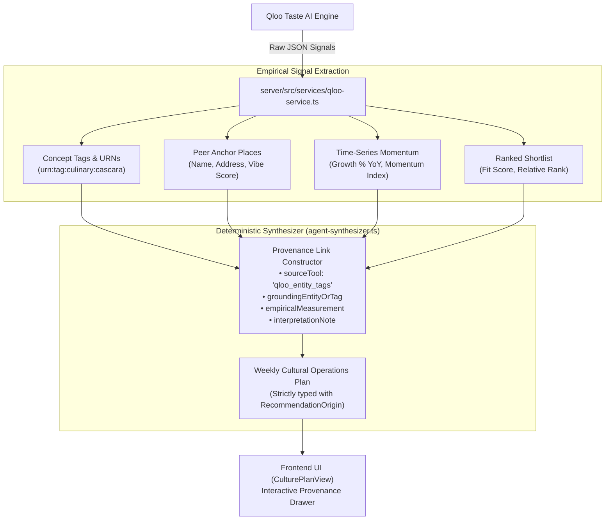

# LocalMuse Ops — Qloo Integration & MCP Protocol Reference

This document provides a technical reference on how **LocalMuse Ops** integrates with the **Qloo Taste AI Engine** through the **Model Context Protocol (MCP)**.

---

## 1. Qloo MCP Architecture

```mermaid
flowchart LR
    subgraph LocalMuseApp["LocalMuse Ops Backend (:4000)"]
        ServiceLayer["Service Layer<br/>(qloo-service.ts)"]
        Executor["MCP Tool Executor<br/>(executor.ts)"]
        StdioClient["MCP Client (@modelcontextprotocol/sdk)<br/>(client.ts)"]
    end

    subgraph TransportLayer["Inter-Process Communication (IPC)"]
        Pipe["stdio streams<br/>(stdin / stdout / stderr)"]
    end

    subgraph QlooSubprocess["Qloo MCP Server (Node.js subprocess)"]
        McpServer["Official Qloo MCP Adapter"]
        HttpTransport["Encrypted HTTPS Client"]
    end

    subgraph QlooCloud["Qloo Global Taste Infrastructure"]
        QlooApi["Qloo Taste Engine<br/>• Entity Ontology<br/>• Affinity Correlation Vectors<br/>• Time-Series Trends<br/>• Audience Contrast Matrix"]
    end

    ServiceLayer -->|executeTool(toolName, args)| Executor
    Executor --> StdioClient
    StdioClient <-->|JSON-RPC 2.0 Messages via stdio| Pipe
    Pipe <--> McpServer
    McpServer -->|HTTPS Authorization: QLOO_API_KEY| HttpTransport
    HttpTransport <-->|REST API JSON Payloads| QlooApi
```

### 1.1 The Stdio Protocol
LocalMuse Ops connects to the Qloo MCP server as a **managed child process** communicating over standard input/output streams (`stdio`). 
- **Zero Port Collisions**: No external TCP socket or HTTP server is exposed for the MCP protocol. Communication is strictly local to the Node.js backend.
- **Process Lifecycle Management**: The backend automatically initializes the MCP client on first tool invocation, monitors subprocess readiness, and closes the stream during server shutdown.

---

## 2. The 7 Qloo MCP Tools Used in LocalMuse Ops

| MCP Tool Name | Primary Purpose in LocalMuse Ops | Workflow Module | Input Schema Highlights |
| :--- | :--- | :--- | :--- |
| **`qloo_find_tags`** | Resolves natural-language business concepts (e.g. *&ldquo;specialty coffee&rdquo;*, *&ldquo;natural wine&rdquo;*) into stable Qloo tag URNs. | Module 01 (Location Insights)<br/>Module 05 (Copilot) | `{ query: string }` |
| **`qloo_recommend`** | Discovers cultural peer anchor places and candidate operational initiatives matching location and concept tags. | Module 01 (Location Insights)<br/>Module 03 (Local Trends)<br/>Module 04 (Recommendations)<br/>Module 05 (Copilot) | `{ target_type: "place" \| "brand", location: string, tags: string[], limit: number }` |
| **`qloo_entity_tags`** | Retrieves characterizing concept tags and aggregate lifestyle descriptors for discovered places or entities. | Module 01 (Location Insights)<br/>Module 05 (Copilot) | `{ entity: string }` (Qloo UUID or place identifier) |
| **`qloo_describe`** | Resolves locality names (e.g. *&ldquo;Austin, TX&rdquo;*, *&ldquo;Nashville, TN&rdquo;*) into verified Qloo locality entities prior to audience contrast. | Module 02 (Audience Comparison)<br/>Module 05 (Copilot) | `{ entity: string, type: "locality" }` |
| **`qloo_compare_audiences`** | Computes the mathematical affinity overlap and divergent cultural traits between two resolved markets. | Module 02 (Audience Comparison)<br/>Module 05 (Copilot) | `{ audience_a: { entities: string[] }, audience_b: { entities: string[] }, target_type: string }` |
| **`qloo_trends`** | Measures multi-quarter popularity velocity and emerging shifts for candidate entities over an ISO date range. | Module 03 (Local Trends)<br/>Module 05 (Copilot) | `{ entities: string[], entity_type: string, start_date: string, end_date: string }` |
| **`qloo_rank`** | Contextually scores and prioritizes a shortlist of candidate initiatives (max 10) against the operator's business goal. | Module 04 (Recommendations)<br/>Module 05 (Copilot) | `{ candidates: string[], profile: { tags: string[], location: string, target_demographic?: string } }` |

---

## 3. How Cultural Signals Are Resolved and Ranked

### 3.1 Resolving Entities Before Querying
Qloo tools require valid entities or tags to produce reliable correlations. LocalMuse Ops adheres strictly to official protocol best practices:
1. **Never Invent Place Entities**: The backend never constructs synthetic place names to feed into `qloo_trends` or `qloo_rank`.
2. **Two-Stage Discovery & Ranking**:
   - **Stage 1 (Discovery)**: Calls `qloo_recommend` using operator tags and location filters to discover an empirical pool of candidate entities.
   - **Stage 2 (Ranking)**: Passes only these verified candidates into `qloo_rank` for multi-attribute scoring against the strategic goal.

### 3.2 Score Interpretation & Mathematical Bounds
- **Qloo Affinity Scores**: Normalized indices ranging from `0` to `100` representing query-relative cultural affinity. Scores from separate calls are not directly comparable because they are calculated relative to each specific query profile.
- **Trend Velocity Indices**: Multi-quarter time-series curves measuring relative shift momentum over a historical window.
- **Illustrative Disclosures**: In Demo Mode, all scores are clearly disclosed as *&ldquo;Illustrative Fit Score /100&rdquo;* or *&ldquo;Illustrative Momentum Index&rdquo;* to ensure complete transparency.

---

## 4. How Evidence Reaches the Agent



Every recommendation presented in the Weekly Culture Plan carries an interactive provenance drawer that reveals:
1. **Grounding Entity / Tag**: The exact concept or place discovered through Qloo.
2. **Empirical Signal**: The measured affinity or trend index returned by the tool.
3. **Source Tool**: The exact MCP tool (`qloo_recommend`, `qloo_rank`, `qloo_trends`, etc.) that produced the data point.
4. **Interpretation Note**: The explicit rationale bridging aggregate taste intelligence into front-of-house hospitality practice.

---

## 5. Secure Credential Configuration

LocalMuse Ops protects event API credentials with strict defense-in-depth isolation:
- **No Browser Access**: `QLOO_API_KEY` is **never exposed** in client-side environment variables (`NEXT_PUBLIC_...`). The browser client only communicates with the Express backend.
- **Backend Environment**: The key is loaded strictly inside `server/.env`:
  ```bash
  # server/.env
  QLOO_API_KEY=your_event_qloo_api_key_here
  PORT=4000
  NODE_ENV=development
  ```
- **Zero Mock Substitution on Auth Failure**: If `QLOO_API_KEY` is missing or rejected by Qloo when querying in Live Mode, the backend immediately fails fast with HTTP 401 (`QLOO_AUTH`). It **never silently substitutes mock data**, guaranteeing that operators always know whether they are viewing live empirical data or offline benchmark fixtures.
