# LocalMuse Ops — System Workflow Journey

This document visualizes the complete end-to-end operator journey through **LocalMuse Ops**, tracking how raw venue attributes are transformed into an actionable 7-day cultural operations schedule, contrasted with generic AI baselines, and preserved across operating shifts.

---

## 1. End-to-End System Workflow Diagram

```mermaid
flowchart TD
    %% Start
    Start(["Operator Initiates Workflow<br/>(Business Profile & Goal)"])

    %% Step 1: Input Profile
    subgraph Phase1["1. Profile Definition & Mode Selection"]
        Inputs["Operator Context<br/>• Business Name & Concept Category<br/>• Primary City & Neighborhood<br/>• Strategic Commercial Objective<br/>• Optional Benchmark City"]
        ModeSelect{"Engine Mode<br/>Selected?"}
        DemoChoice["Demo Mode<br/>(Curated Benchmark Fixtures)"]
        LiveChoice["Live Qloo Mode<br/>(Requires QLOO_API_KEY)"]
    end

    %% Step 2: Location Insights
    subgraph Phase2["2. Location Insights (Module 01)"]
        W1_TagSearch["Tag Concept Search<br/>(qloo_find_tags)"]
        W1_PlaceRec["Peer Anchor Discovery<br/>(qloo_recommend places)"]
        W1_EntityTags["Concept Tag Enrichment<br/>(qloo_entity_tags)"]
        W1_Output["Location Insights Signal<br/>• Top 5 Cultural Anchor Venues<br/>• Defining Lifestyle Concept Tags<br/>• Target Age Demographic Indexing"]
    end

    %% Step 3: Audience Comparison (Conditional)
    subgraph Phase3["3. Audience Contrast (Module 02 - Conditional)"]
        W2_Check{"Benchmark City<br/>Provided?"}
        W2_Skip["Skip Audience Contrast<br/>(Preserve Schedule Rhythm)"]
        W2_Describe["Resolve Localities<br/>(qloo_describe loc A & B)"]
        W2_Compare["Contrast Audiences<br/>(qloo_compare_audiences)"]
        W2_Output["Audience Contrast Signal<br/>• Cross-Market Shared Affinities<br/>• Distinguishing Regional Traits<br/>• Behavioral Divergence Takeaway"]
    end

    %% Step 4: Local Trends
    subgraph Phase4["4. Local Trends & Velocity (Module 03)"]
        W3_RecSeed["Seed Candidate Discovery<br/>(qloo_recommend entities)"]
        W3_Trends["Time-Series Momentum<br/>(qloo_trends over ISO date range)"]
        W3_Output["Local Trends Signal<br/>• 6-Quarter Cultural Velocity Curves<br/>• Emerging Shifts & YoY Growth Rates<br/>• Neighborhood Affinity Density Heatmaps"]
    end

    %% Step 5: Tactical Recommendations & Ranking
    subgraph Phase5["5. Tactical Ranking (Module 04)"]
        W4_Discover["Candidate Discovery<br/>(qloo_recommend 1–10 initiatives)"]
        W4_Rank["Multi-Attribute Ranking<br/>(qloo_rank against Goal Profile)"]
        W4_Output["Ranked Opportunities Signal<br/>• Prioritized Initiatives (#1, #2, #3)<br/>• Qloo Affinity / Fit Scores<br/>• Operational Effort Tiers (Low/Med/High)<br/>• Strategic Rationales & Milestones"]
    end

    %% Step 6: Agent Synthesis
    subgraph Phase6["6. Cognitive Orchestration & Synthesis"]
        Synthesizer["Deterministic Grounded Synthesizer<br/>(server/src/services/agent-synthesizer.ts)"]
        ProvenanceTagging["Provenance & Origin Binding<br/>• origin: qloo_evidence<br/>• origin: agent_derived<br/>• Source Tool & URN Trace"]
        PlanAssembly["Assemble 8 Plan Sections<br/>1. Executive Strategy Thesis<br/>2. Cultural Anchors & Demographics<br/>3. Specials & Menu Pairings<br/>4. Events & Artisan Partnerships<br/>5. Soundscape & Lighting Pacing<br/>6. Day-by-Day Social Calendar<br/>7. Monday–Sunday Operational Shifts<br/>8. Expected Impact & Disclosures"]
    end

    %% Step 7: Operations Review, Contrast & Local Memory
    subgraph Phase7["7. Operator Review, Evaluation & Local Memory"]
        WeeklyPlan["Weekly Culture Plan Display<br/>(Interactive Provenance Drawers)"]
        ContrastTrigger{"Operator Toggles<br/>Generic Contrast?"}
        ContrastView["PlanComparisonView (Step 13)<br/>Side-by-Side Evaluation Across 5 Dimensions:<br/>• Cultural Relevance<br/>• Local Context<br/>• Evidence Provenance<br/>• Recommendations<br/>• Practicality"]
        FeedbackTrigger["PlanFeedbackCard (Step 14)<br/>• 1–5 Star Feasibility Rating<br/>• Diagnostic Tags (Relevant, Expensive, etc.)<br/>• Optional 280-char Shift Note"]
        LocalSave[("Save to Local Device Memory<br/>(Browser LocalStorage)")]
        ExportAction["Export Plan (Markdown)<br/>Copy to Clipboard for Staff Notes"]
        NextCycle["Subsequent Plan Generations<br/>(Prior Operator Memory Loaded)"]
    end

    %% Connect Journey
    Start --> Inputs
    Inputs --> ModeSelect
    ModeSelect -->|Demo| DemoChoice --> W1_TagSearch
    ModeSelect -->|Live| LiveChoice --> W1_TagSearch

    %% Location Insights Flow
    W1_TagSearch --> W1_PlaceRec --> W1_EntityTags --> W1_Output
    W1_Output --> W2_Check

    %% Audience Comparison Branch
    W2_Check -->|Yes| W2_Describe --> W2_Compare --> W2_Output --> W3_RecSeed
    W2_Check -->|No| W2_Skip --> W3_RecSeed

    %% Trends Flow
    W3_RecSeed --> W3_Trends --> W3_Output --> W4_Discover

    %% Recommendations Flow
    W4_Discover --> W4_Rank --> W4_Output --> Synthesizer

    %% Synthesis Flow
    W1_Output -.-> Synthesizer
    W2_Output -.-> Synthesizer
    W3_Output -.-> Synthesizer
    Synthesizer --> ProvenanceTagging --> PlanAssembly --> WeeklyPlan

    %% Downstream Actions
    WeeklyPlan --> ContrastTrigger
    ContrastTrigger -->|Yes| ContrastView
    ContrastTrigger -->|No| FeedbackTrigger
    ContrastView --> FeedbackTrigger
    WeeklyPlan --> ExportAction
    FeedbackTrigger --> LocalSave --> NextCycle
    NextCycle -.->|Contextual Pre-fill| Inputs
```

---

## 2. Key Workflow Milestones

### Milestone 1: Multi-Signal Profile Definition
The operator specifies the enterprise profile (e.g. *Flat Track Coffee & Roasters*, Austin, East Austin) and their target operational goal (e.g. *Increase weekday afternoon footfall from 1:30–4:30 PM*). Operators can choose to benchmark against a contrasting market (e.g. Nashville, TN) or evaluate their market independently.

### Milestone 2: Automated Chained Intelligence Queries
The central agent orchestrator executes the four discovery workflows in sequence:
1. **Location Insights**: Queries `qloo_find_tags` &rarr; `qloo_recommend (places)` &rarr; `qloo_entity_tags` to uncover high-affinity anchor venues (e.g. local record stores, ceramicists) and lifestyle concept tags.
2. **Audience Comparison**: If a benchmark city is provided, calls `qloo_describe` &rarr; `qloo_compare_audiences` to uncover shared affinities vs distinguishing regional traits.
3. **Local Trends**: Seeds entities via `qloo_recommend` and evaluates time-series velocity via `qloo_trends` across multi-quarter windows.
4. **Tactical Ranking**: Generates candidate initiatives via `qloo_recommend` and scores them contextually via `qloo_rank`.

### Milestone 3: Deterministic Grounded Synthesis
The backend synthesizer maps these verified signals into 8 cohesive operational plan sections:
- Executive Strategy & Operations Thesis.
- Cultural Anchors & Target Demographic Profiling.
- Weekly Specials & High-Margin Menu Features.
- Community Events & Micro-Artisan Partnerships.
- Atmosphere & Soundscape Pacing (decibel targets and tempo guidance).
- Day-by-Day Social Storytelling Calendar (with one-click caption copying).
- Actionable Monday–Sunday Shift Calendar with staff milestones.
- Expected Impact and empirical grounding data points.

### Milestone 4: Practical Contrast (Step 13)
Operators can click **&ldquo;Compare with Generic AI&rdquo;** to evaluate their generated plan against a deterministic generic LLM baseline across 5 core dimensions (Cultural Relevance, Local Context, Provenance, Recommendations, and Practicality).

### Milestone 5: Local Operator Feedback & Memory (Step 14)
Operators rate the plan from 1 to 5 stars, attach diagnostic tags (e.g. *Too expensive*, *Difficult to implement*), and record short shift notes. This memory is persisted on their local device, providing continuous operational learning for future plan iterations without requiring external cloud databases.
